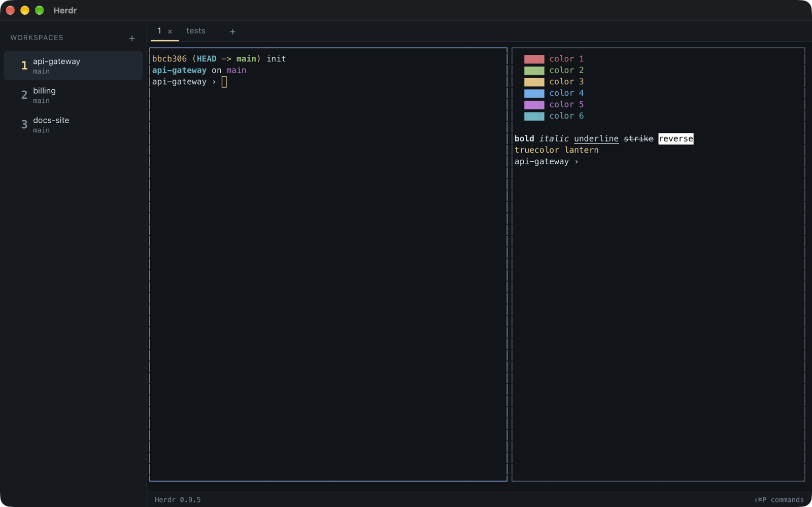
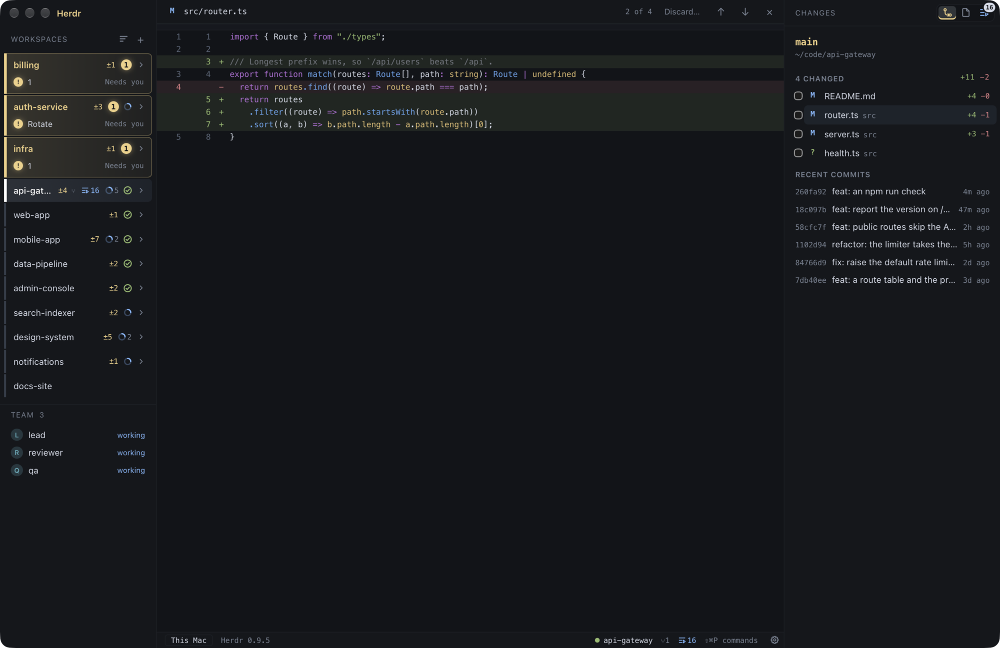

# Herdr Tauri

[](https://github.com/iloire/herdr-tauri/actions/workflows/ci.yml)

A desktop client for the [Herdr](https://herdr.dev) daemon whose UI is written in TypeScript, so the UI can
be changed with hot reload instead of a Rust rebuild. It is a port of the fundamentals of
[herdr-gpui](https://github.com/penso/herdr-gpui): the workspace sidebar, tabs, split panes, the terminal
surface, keyboard, mouse, and paste input, and the command catalog with its shortcuts. A Changes panel shows
what changed in the checkout you are working in, with each file's diff.

It's for people who already run Herdr and want a native window on their sessions they can change quickly.
Like herdr-gpui it is only a client: closing it leaves the daemon and every terminal running.





## How it is split

- **TypeScript (`src/`)**: everything you see. React draws the chrome, and a canvas painter draws the
  daemon's cell grid.
- **Rust (`src-tauri/`)**: a thin bridge. It links `herdr-client`, `herdr-commands`, and `herdr-vcs` from
  herdr-gpui (pinned by commit), so the wire format and Git reads are never ported by hand, and exposes them
  as Tauri commands.

[docs/architecture.md](docs/architecture.md) covers the data flow, the IPC contract, and where to add things.

## Run it

Needs Node 20+, Rust (the pinned toolchain installs itself through `rustup`), and a running Herdr daemon.

```sh
npm install
npm run tauri dev       # hot-reloading app, attached to your default Herdr session
```

It finds the daemon the way herdr-gpui does. `HERDR_SOCKET_PATH`, `HERDR_CLIENT_SOCKET_PATH`, and
`HERDR_SESSION` override that. A shell inside a Herdr pane already has `HERDR_SOCKET_PATH` set, so to try it
against a throwaway daemon, set both socket variables.

## Check it

```sh
npm run check           # typecheck, Vitest, cargo test, clippy -D warnings
```

CI runs the same checks and then `tauri build` on every push to `main` and on every pull request.

## Build it

```sh
npm run tauri build     # release bundle in src-tauri/target/release/bundle/
```

Nothing deploys yet. Builds are local and unsigned.

## Status

Working: the core terminal client, a read-only Changes panel with diffs ([plan](docs/plan-changes.md)),
and agent status at a glance: each workspace's agents listed under it with a mark for working, waiting on
you (with a count), done, or idle, and the Dock badge and window title counting agents that finished or need
you ([plan](docs/plan-agent-status.md)). The sidebar resizes from its edge, each workspace's branch line counts
its changed files, and right-clicking a workspace opens its folder in VS Code, GitHub Desktop, or the file
manager, or copies its path. Right-clicking a tab opens a new tab, or renames, pins, moves to another
workspace, or closes it.
Still to come, roughly in priority order: commit and push, GitHub pull requests, text selection and copy,
find, terminal graphics, hyperlinks, renaming workspaces, the config file and themes,
system notifications, usage, the orchestrator, and remote machines.
