# 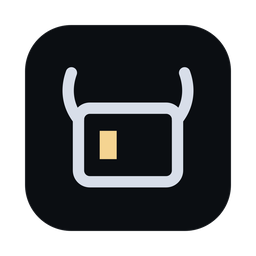 Herdr Miura

[](https://github.com/iloire/herdr-miura/actions/workflows/ci.yml)

A desktop home for running many coding agents at once. See which agent needs you, review what it changed, and line
up its next jobs, all in one window.

It is a client for the [Herdr](https://herdr.dev) daemon, so closing the window leaves every agent and terminal running.

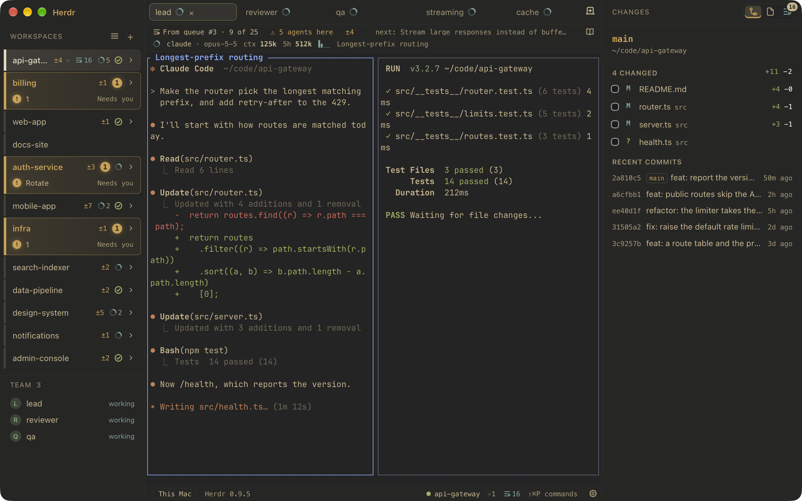

<sub>Every screenshot shows made-up projects on a throwaway daemon, at the load of a busy day: 12 workspaces, 20 agents, 16 queued prompts.</sub>

## See what needs you

Each workspace card shows its agents at a glance: working, finished, or waiting on you. Sort by attention and the ones
stuck on a question rise to the top, in gold. The Dock badge and window title count them too. A header over each tab
shows every session's model, context and spend, and warns when two agents share a checkout.

A workspace can name a team of agents in `.herdr/team.json`. The sidebar lists each role with what it is doing, and
starts the ones not running ([docs/team.md](docs/team.md)).

Right-click a workspace to rename it, pick its color, start a team, queue a prompt or open it in your editor. Tabs have
a menu too, for pinning one, marking it seen, queueing a prompt, opening its folder or moving it to another workspace.

<table>
  <tr>
    <td>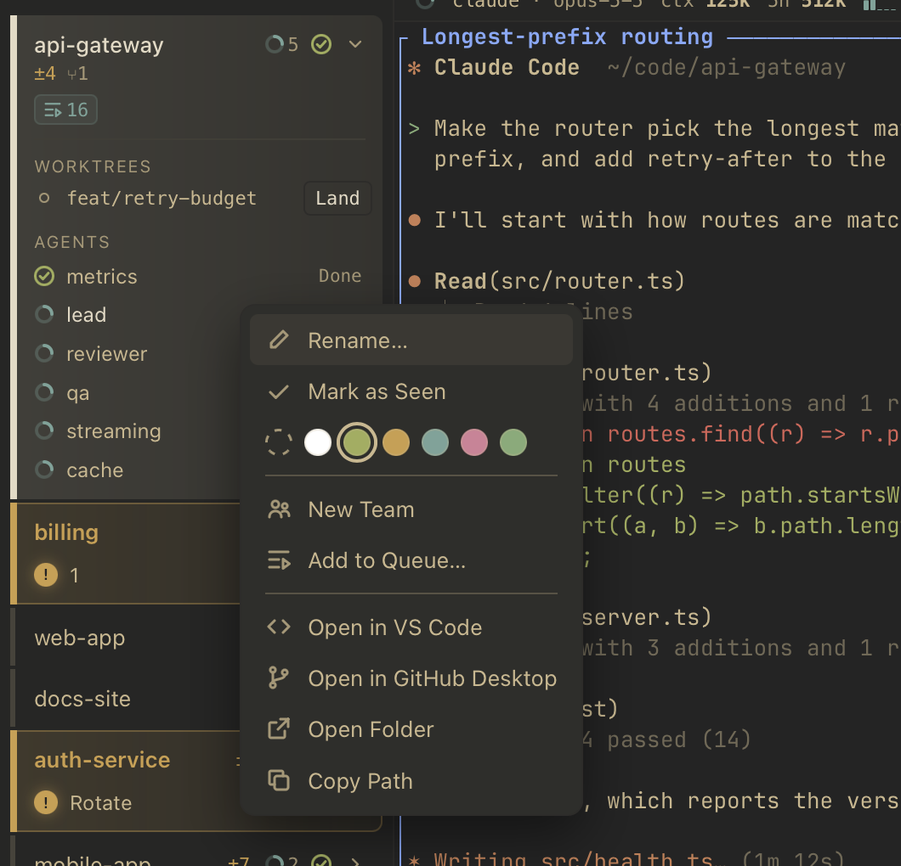</td>
    <td>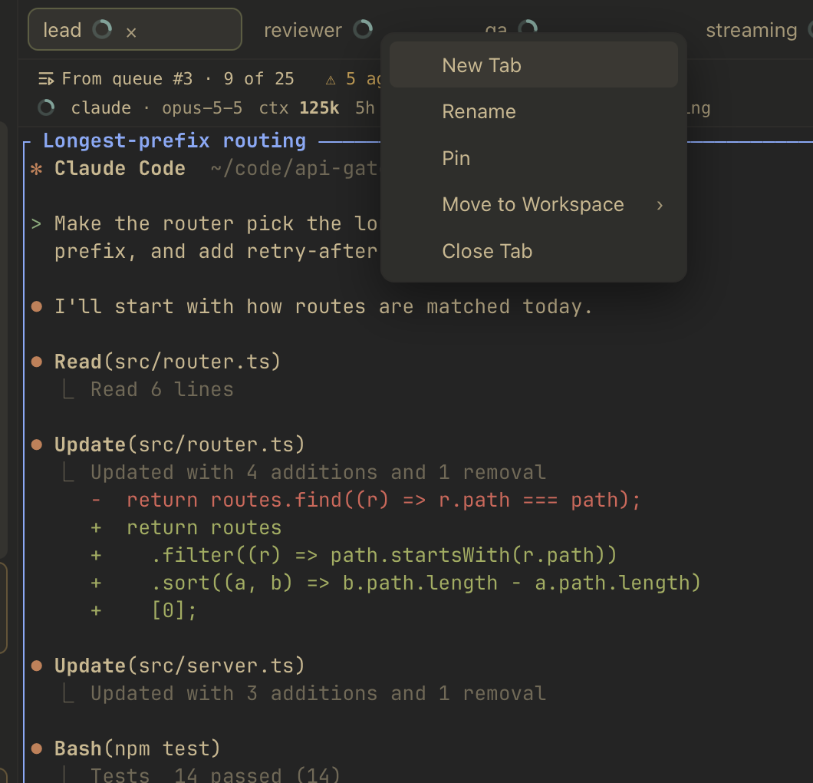</td>
  </tr>
</table>

## Queue up the next jobs

Hand a workspace as many prompts as you like (⌘⇧A). Each one runs in a new tab with a fresh Claude session, and the next
waits until nothing else there is at work and the tree is clean ([docs/plan-agent-queue.md](docs/plan-agent-queue.md)).

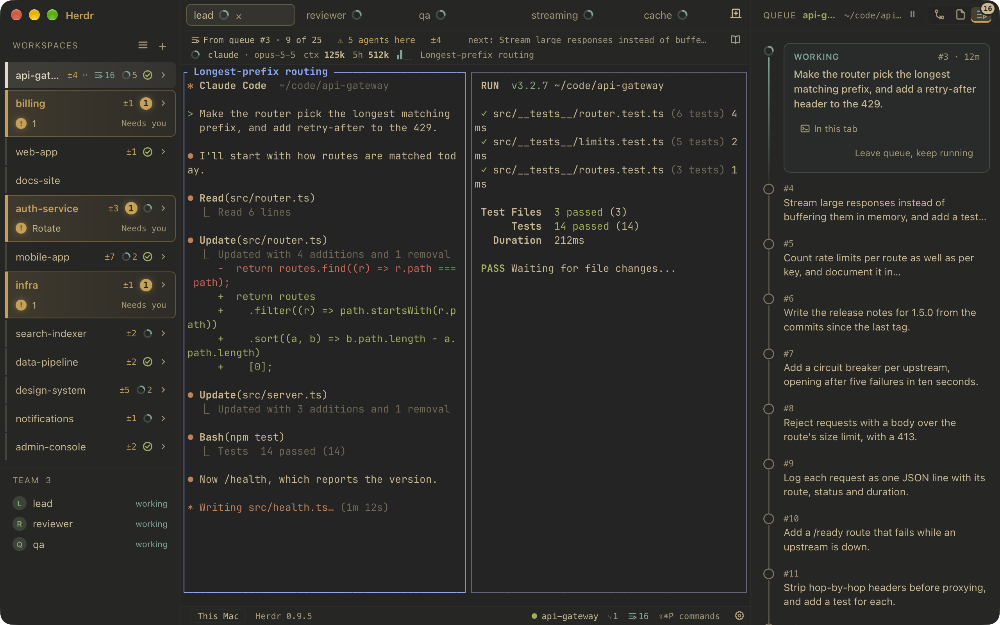

## Review every change

The Changes panel shows what changed in the checkout you are in, with each file's diff and what each recent commit did.
Tick files to commit them, discard one to the Trash, and fetch, push or fast-forward without leaving the window. It
never stages, merges, rebases or stashes behind your back ([docs/plan-changes.md](docs/plan-changes.md)).


## Land a worktree in one click

A worktree with commits main lacks has **Land** on its row. After you confirm, it runs the repo's check, rebases onto
main, fast-forwards main, then removes the worktree and branch. It stops at the first failure and says what it left. It
never forces, stashes or pushes.

The check is `.herdr/land.json` (`{ "check": "<shell command>" }`), a `check` script in `package.json`, or a `check:`
make target.

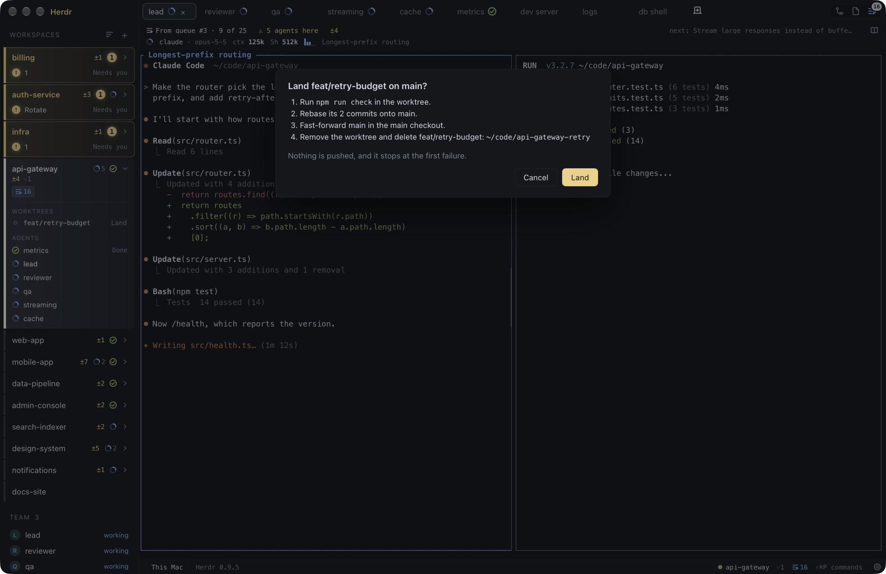

## Browse files and reuse prompts

The Files panel (⌘⇧E) walks the whole checkout with a filter, and opens any file's text or image, or a Markdown file as
a rendered page.

The prompt library (⌘⇧L) opens Claude Code's own command files, from `.claude/commands/` and
`~/.claude/commands/`. Edit one, then send it to the focused agent, to a fresh Claude in a new tab, or to the queue
([docs/plan-prompt-library.md](docs/plan-prompt-library.md)).

<table>
  <tr>
    <td>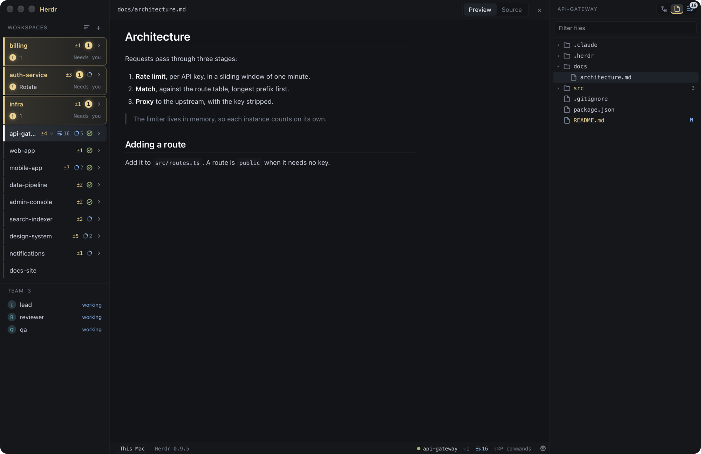</td>
    <td>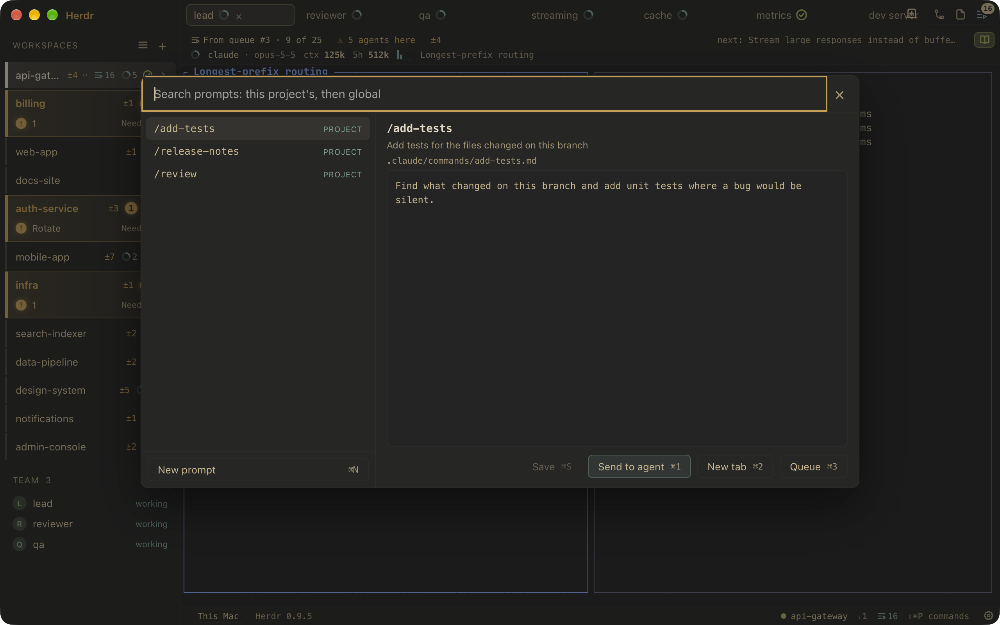</td>
  </tr>
</table>

## Make it yours

Eight built-in themes, any Ghostty theme, or a light and dark pair that follows macOS. Settings (⌘,) writes
`~/.config/herdr/config-tauri.toml` as you change things: the theme, the fonts and what a new tab runs
([docs/settings.md](docs/settings.md)).

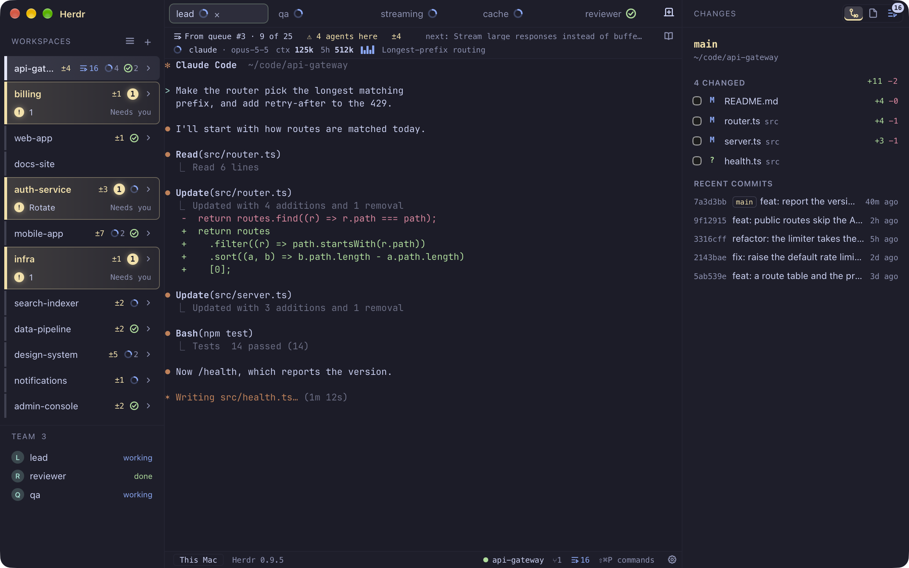

<table>
  <tr>
    <td>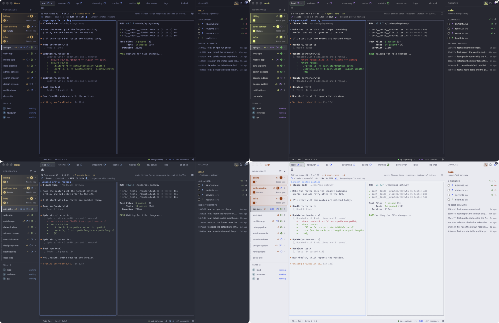</td>
    <td>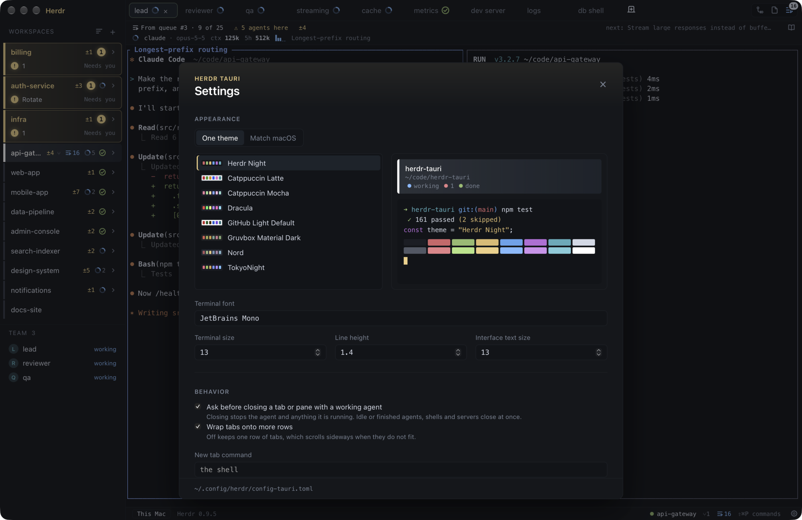</td>
  </tr>
</table>

## And the rest

- Split panes, tabs that wrap or scroll, pins, and moving a tab to another workspace.
- ⌘-click a URL or a commit hash in a terminal. A hash opens that commit's diff.
- A ↻ on any Claude session that `/loop` will run again, with its next wakeup.
- Attach to Herdr on another machine over SSH, one host at a time ([docs/ssh.md](docs/ssh.md)).
- A command palette (⌘⇧P) with every command and shortcut.

## Run it

Needs Node 20.19+ or 22.12+, Rust (the pinned toolchain installs itself through `rustup`) and a running Herdr daemon.

```sh
npm install
npm run tauri dev       # hot-reloading app, attached to your default Herdr session
```

The UI is TypeScript, so it changes with hot reload instead of a Rust rebuild.

It finds the daemon by Herdr's own rules. `HERDR_SOCKET_PATH`, `HERDR_CLIENT_SOCKET_PATH` and `HERDR_SESSION` override
that. A shell inside a Herdr pane already has `HERDR_SOCKET_PATH` set, so to try it against a throwaway daemon, set both
socket variables and start that daemon with its own `HOME`. With the same `HOME`, a second `herdr server` restores a
copy of your saved session and shares its state folder.

A dev window on any branch but `main` has a colored strip along its foot naming its branch, so it can't be mistaken for
the app you use every day. To run a branch beside the one you have open, give it its own port:

```sh
npx tauri dev --config '{"build":{"devUrl":"http://localhost:1430","beforeDevCommand":"npx vite --port 1430 --strictPort"}}'
```

## Check it

```sh
npm run check           # typecheck, Vitest, cargo test, clippy -D warnings
```

CI runs the same checks and then `tauri build` on every push to `main` and on every pull request.

## Build it

```sh
npm run tauri build     # release bundle in src-tauri/target/release/bundle/
```

Nothing deploys yet. Builds are local and unsigned. [docs/channels.md](docs/channels.md) describes two builds that can
run side by side: a pinned Stable, and an Edge that rebuilds after every commit on `main`.

## How it is split

- **TypeScript (`src/`)**: everything you see. React draws the chrome, and a canvas painter draws the daemon's cell grid.
- **Rust (`src-tauri/`)**: a thin bridge with its own client of the daemon (`src-tauri/src/herdr/`, wire types copied
  from Herdr 0.9.5 with attribution) and its own Git reads, exposed as Tauri commands.

It began as a port of the fundamentals of [herdr-gpui](https://github.com/penso/herdr-gpui) and depends on none of its
code. [docs/architecture.md](docs/architecture.md) covers the data flow, the IPC contract and where to add things.

## Not yet

Text selection and copy in the terminal, find, terminal graphics, GitHub pull requests, system notifications and custom
key bindings.

More support for SSH remote hosts is coming soon. Terminals and agents work there today, but the Changes panel, the
queue, teams, the prompt library and the file browser only work locally, not on the remote host
([docs/ssh.md](docs/ssh.md)).
