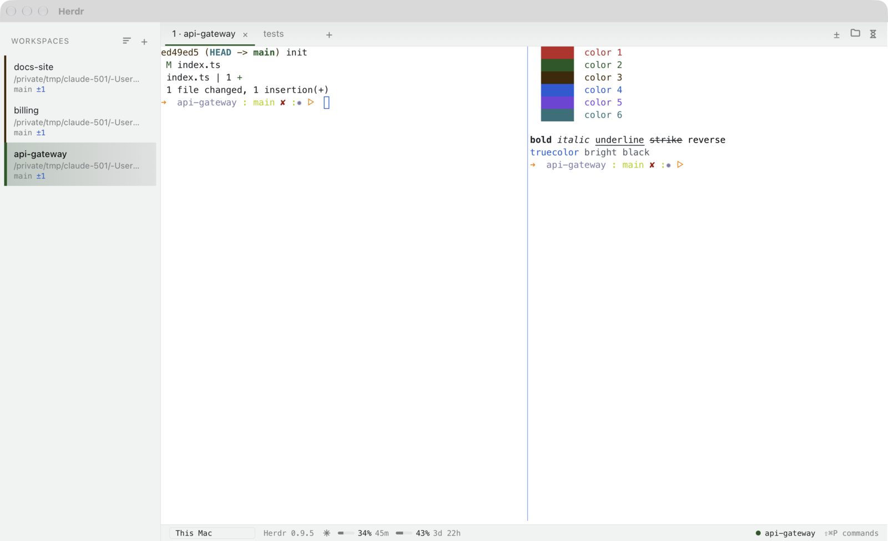

# Herdr Tauri

[](https://github.com/iloire/herdr-tauri/actions/workflows/ci.yml)

A desktop client for the [Herdr](https://herdr.dev) daemon whose UI is written in TypeScript, so the UI can
be changed with hot reload instead of a Rust rebuild. It is a port of the fundamentals of
[herdr-gpui](https://github.com/penso/herdr-gpui): the workspace sidebar, tabs, split panes, the terminal
surface, keyboard, mouse, and paste input, and the command catalog with its shortcuts. A Changes panel shows
what changed in the checkout you are working in, with each file's diff, and what each recent commit changed.
It fetches in the background so ↑ and ↓ stay true, pushes, publishes and fast-forwards a branch, and lists the commits each would move.
A Files panel (⌘⇧E) browses the whole checkout as a tree with a filter, and opens any file's text or image, a Markdown file rendered as a page,
over the terminal.
A workspace can name a team of agents in `.herdr/team.json`: the sidebar lists each role, a Claude Code
session in its own tab, with what it is doing, and starts the ones not running ([docs/team.md](docs/team.md)).
Each workspace also has a prompt queue, a panel beside Changes and Files (⌘⇧A): prompts you hand it run one at a time, each in a new tab
and a fresh Claude session, the next only once nothing else there is at work and the tree is clean
([docs/plan-agent-queue.md](docs/plan-agent-queue.md)).
Prompts you send often are Claude Code's own command files (`~/.claude/commands/*.md` and a repo's
`.claude/commands/*.md`): ⌘⇧L opens them in a palette, project ones first, where you can edit the text and
send it to the focused agent, to a fresh Claude in a new tab, or to the queue
([docs/plan-prompt-library.md](docs/plan-prompt-library.md)).
Settings live in `~/.config/herdr/config-tauri.toml`, which the Settings dialog writes as you change
things: the theme (herdr-gpui's theme names, any Ghostty theme, or a light and dark pair that follows macOS),
the terminal's font, size and line height, the interface text size, and what a new tab runs
([docs/settings.md](docs/settings.md)). Open the dialog from the Herdr menu → **Settings…** or with ⌘,
(Ctrl+, on Linux and Windows, which have no app menu).

It's for people who already run Herdr and want a native window on their sessions they can change quickly.
Like herdr-gpui it is only a client: closing it leaves the daemon and every terminal running.




## How it is split

- **TypeScript (`src/`)**: everything you see. React draws the chrome, and a canvas painter draws the
  daemon's cell grid.
- **Rust (`src-tauri/`)**: a thin bridge with its own client of the daemon (`src-tauri/src/herdr/`, wire
  types copied from Herdr 0.9.5 with attribution) and its own Git reads, exposed as Tauri commands. It
  depends on no herdr-gpui code.

[docs/architecture.md](docs/architecture.md) covers the data flow, the IPC contract, and where to add things.

## Run it

Needs Node 20+, Rust (the pinned toolchain installs itself through `rustup`), and a running Herdr daemon.

```sh
npm install
npm run tauri dev       # hot-reloading app, attached to your default Herdr session
```

It finds the daemon by Herdr's own rules. `HERDR_SOCKET_PATH`, `HERDR_CLIENT_SOCKET_PATH`, and
`HERDR_SESSION` override that. A shell inside a Herdr pane already has `HERDR_SOCKET_PATH` set, so to try it
against a throwaway daemon, set both socket variables.

A dev window on any branch but `main` has a colored strip along its foot naming its branch (`DEV · feat/x`), and the branch in its
title, so it can't be mistaken for the app you use every day. To run a branch beside the one you already
have open, give it its own port:

```sh
npx tauri dev --config '{"build":{"devUrl":"http://localhost:1430","beforeDevCommand":"npx vite --port 1430 --strictPort"}}'
```

## Check it

```sh
npm run check           # typecheck, Vitest, cargo test, clippy -D warnings
```

CI runs the same checks and then `tauri build` on every push to `main` and on every pull request.

## Build it

```sh
npm run tauri build     # release bundle in src-tauri/target/release/bundle/
```

Nothing deploys yet. Builds are local and unsigned. On this Mac two builds run side by side: a pinned
Stable, and an Edge that rebuilds and restarts after every commit on `main` ([channels](docs/channels.md)).

## Status

Working: the core terminal client, a Changes panel with diffs that fetches, pushes and pulls but never
stages, commits, merges, rebases or stashes ([plan](docs/plan-changes.md)),
and agent status at a glance: each workspace's agents listed under it with a mark for working, waiting on
you (with a count), done, or idle, and the Dock badge and window title counting agents that finished or need
you ([plan](docs/plan-agent-status.md)), plus a ↻ on the tab and workspace card of a Claude session that `/loop`
will run again (read from a tag Claude Code's hooks report, see [architecture](docs/architecture.md)). A header
over each tab with agents shows each session's model, context, spend this plan window and its last 15 minutes
([plan](docs/plan-tab-header.md)). The sidebar resizes from its edge, each workspace's branch line counts
its changed files, and right-clicking a workspace opens its folder in VS Code, GitHub Desktop, or the file
manager, or copies its path. Workspaces sort by hand, dragged into place (the daemon keeps that order), or
by attention, with those waiting on you first. Right-clicking a tab opens a new tab, or renames, pins, moves to another
workspace, or closes it. The status bar's host picker attaches to Herdr on another machine over SSH, one host
at a time, and asks before trusting a new host's key ([how](docs/ssh.md)). A settings file and a Settings
dialog (⌘,) choose the theme, fonts and a few behaviors ([settings](docs/settings.md), [plan](docs/plan-settings.md)).
Still to come, roughly in priority order: commit, GitHub pull requests, text selection and copy,
find, terminal graphics, hyperlinks, renaming workspaces, more settings (status bar items, the Dock badge,
key bindings), system notifications, usage, the orchestrator, and the Changes panel on remote machines.
